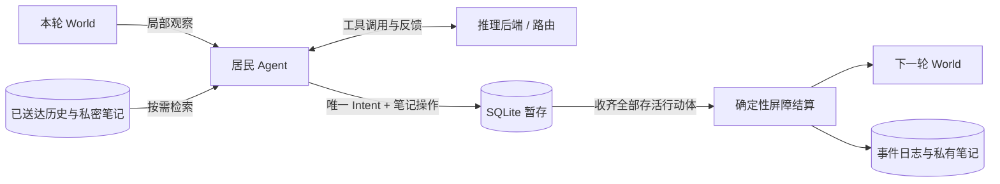

# Project Herd

**Project Herd** 是一个零外部依赖的确定性多智能体社会动力学模拟引擎（ABM），仅需 **Python 3.10+ 标准库与 SQLite**。

引擎将**世界物理规则**与**声明式剧本**彻底解耦：所有角色（无论是单个关键人物，还是代表十余至数十人的群体单元）都在同一套 `polity-v1` 通用物理与信息法则下自主观察、记忆、谈判、结盟、传播文书、控制通道或爆发冲突，不存在任何角色特权或预设剧情脚本。每一轮模拟都支持**完整确定性回放、局部信息溯源审计与隐私隔离校验**。

---

## 核心特性

- **严格局部信息与可验证隐私**：居民仅能看到所在房间的物理状态、同桌发言、本地公墙与自身已送达的历史；私语与远程联络经独立重放审计，确保正文绝不泄露给第三方状态。
- **个体与群体（Pop）共存**：每个行动体拥有规模 `size` 与训练/组织度 `discipline`（`0~1`），同一引擎即可同时模拟关键个人（`size=1`）、高纪律建制单位与低组织度自发人群。
- **普世物理与社会机制**：支持有向通道封锁与地面物资看护（`guard`）、非致命缴械与冲突目击（`force`）、现货/承诺契约（`offer`/`accept`）、印刷复制与按规模加权的公墙联署（`press`/`endorse`）、昼夜天色循环，以及有线站点与便携电台组成的跨房通讯网络。
- **原生工具循环与多模型混跑**：支持 OpenAI 兼容网关的原生 `agent_loop`（多步查证、私密笔记、并行暂存发言与提交行动）与单步 `json` 模式，内置前缀队列调度以提升 KV Cache 复用，并可按角色组、比例或编号把居民路由给不同 LLM 后端。
- **确定性存档与 IEMP 量化分析**：所有决策、事件、笔记与世界快照原子落盘 SQLite，支持随时中断续跑、按预算分批决策、存档分叉（`fork`），并一键导出思想（I）、经济（E）、军事（M）、政治（P）四维逐轮指标与模型归因报告。

---

## 快速开始

### 1. 离线试跑与测试（无需 API 密钥）

```bash
# 查看内置虚构剧本
python3 -m herd scenarios

# 初始化存档并离线运行 12 轮
python3 -m herd init --scenario citystate-coup --seed 7 --db /tmp/citystate.sqlite
python3 -m herd run --db /tmp/citystate.sqlite --backend scripted --ticks 12 --workers 4

# 查看状态、校验确定性回放、导出完整审计与 IEMP 报告
python3 -m herd stats --db /tmp/citystate.sqlite
python3 -m herd replay --db /tmp/citystate.sqlite
python3 -m experiments.report_polity /tmp/citystate.sqlite --export-trace /tmp/citystate.jsonl

# 启动零依赖实时故事剧场 WebUI（支持直播轮询、人物 POV 追剧与时代主题包）
python3 -m herd serve --runs runs --port 8765

# 运行全部单元测试与集成测试
python3 -m unittest discover -s tests -v
```

### 2. 接入 OpenAI 兼容模型（单模型 / 大小模型混跑）

单模型运行（通过环境变量 `HERD_API_KEY` 提供密钥，默认 `agent_loop` 模式）：

```bash
export HERD_API_KEY="your-api-key"
python3 -m herd run --db /tmp/citystate.sqlite --backend api \
  --base-url "https://your-gateway.example/v1" --model "your-model" \
  --mode agent_loop --max-steps 6 --ticks 12 --workers 4
```

多模型混跑（例如让高智商云端模型扮演关键个体，让高速小模型扮演基层群体）：创建 `backends.json` 并通过 `--backends` 启动：

```json
{
  "default": "local",
  "profiles": {
    "local": {
      "type": "api",
      "mode": "agent_loop",
      "max_steps": 5,
      "base_url": "http://localhost:8000/v1",
      "model": "small-fast-model",
      "api_key_env": "LOCAL_API_KEY",
      "max_tokens": 1536,
      "workers": 4
    },
    "cloud": {
      "type": "api",
      "mode": "agent_loop",
      "max_steps": 5,
      "base_url": "https://gateway.example/v1",
      "model": "large-reasoning-model",
      "api_key_env": "CLOUD_API_KEY",
      "max_tokens": 3072,
      "workers": 6
    }
  },
  "routes": [
    {"profile": "cloud", "group": "conciliator"},
    {"profile": "cloud", "group": "hardliner"},
    {"profile": "cloud", "group": "student_bloc", "random": 1, "seed": 42}
  ]
}
```

```bash
python3 -m herd init --scenario bayport-crisis --seed 42 --db /tmp/bayport.sqlite
python3 -m herd run --db /tmp/bayport.sqlite --backends backends.json --ticks 63 --window 0 --context-bytes 90000
```

> 常用运维命令：`--decision-budget N` 按决策数分批续跑；`python3 -m herd inspect r000 --db ...` 查看单个居民状态与记忆；`python3 -m herd fork --db ... --to branch.sqlite` 在任意节点分叉对照实验。

---

## 内置虚构剧本

所有内置剧本均为完全架空的世界观设定，仅用于测试多智能体在稀缺、动员、信息传播与权力博弈中的涌现规律：

| 剧本 ID | 名称 | 默认规模 | 核心结构特点 | 文件 |
| :--- | :--- | :--- | :--- | :--- |
| `citystate-coup` | 瓦尔登城邦危机 | 54 个体（纯 `size=1`） | 6 节点古典城邦、单一国玺、纯面对面与物理送信、风暴减产与寒潮耗能冲击 | [citystate-coup.json](herd/scenarios/citystate-coup.json) |
| `bayport-crisis` | 白湾城宪政危机 | 57 Agent（20 个体 + 37 Pop，总人口 680） | 13 节点工业联邦首都与远郊驿道、内卫门禁与密室实物密账、元老近卫/内卫/巡防/本地驻军/远郊铁卫多层武装、三枚竞争印信、跨房通联与暗线搅局者 | [bayport-crisis.json](herd/scenarios/bayport-crisis.json) |

---

## 架构与结算流程



| 模块 | 职责 |
| :--- | :--- |
| `herd/model/` | 领域实体（`Person`、`Place`、`GuardPosture`、`Document`、`Offer`）、昼夜时钟（`time.py`）、声明式剧本加载与校验（`scenario/`）及局部视野投影（`observation.py`）。 |
| `herd/systems/` | 基于统一轮初快照依次执行：通信（`comm`）、值守登记（`gates`）、武力对抗（`combat`）、和平移动（`gates`）、经济与契约（`economy`）、文书与署名（`documents`）、自然时钟与冲击（`clock`）。 |
| `herd/runtime/` | 原生工具循环（`agent/`）、多后端路由与前缀缓存调度（`backends/`、`prefix.py`）、提示词构建与上下文折叠（`memory.py`）、SQLite 事务存储与回放（`storage/`）。 |
| `herd/scenarios/` | 声明式 JSON 剧本文件；引擎代码对剧本 ID、角色名和物品名保持零硬编码。 |
| `experiments/` | 完整重放与隐私隔离审计（`audit/`）、逐轮 IEMP 与传播指标（`metrics/`）及报告导出工具（`report_polity.py`）。 |

---

## 世界规则速览（`polity-v1`）

### 1. 个体与群体（`size`、`initial_size` 与 `discipline`）
- **规模与拆分不变性战力**：`initial_size=1` 为独立个体，`initial_size>1` 为集体单元（即便战斗减员至 `size=1` 仍保留原编制身份，保住提示词与 KV Cache）。单单位有效规模按 `size ** (0.3 + 0.6 * discipline)` 计算，同训练度多单位合战遵循相同指数的规模一致性合成（消除拆分 Pop 带来的战力膨胀）。
- **后勤与影响力**：负重上限按 `round(carry_cap * sqrt(size))` 放大；吃一份食物恢复 `max(1, round(energy_restore / sqrt(size)))` 点体能；公墙联署同时记录 `signed`（署名行动体数）与 `signed_weight`（署名者当前 `size` 总和）。

### 2. 通道控制、交战规则（ROE）、兰开斯特战斗与永久减员
- **`guard` 四种普世目标**：`path:<邻地>`（单向阻拦来自该邻地的进入者，不困住屋内离开者）、`path:*`（双向封锁全屋出入口并保护地面物品）、`items`（仅保护本屋地面物品与文书）、`person:<同地编号>`（贴身护卫）。放行条件可用分号组合 `allow:编号列表`、`seal:印信` 与 `known`（熟人）；仅当阻挡方总战力严格超过放行方时拦截生效。
- **持久 ROE 与声明式 `force_modes`**：每个行动体持有持久交战档位 `roe`，可通过并行内部工具 `set_roe` 随时切换（同屋与路口均肉眼可见，切换记录见 `recent_room.roe_changes`）。剧本在 `rules.force_modes` 中声明档位物理参数（`severity`、`lethal_arms_scale`、`damage_scale`、`lethal`、兰开斯特指数 `lanchester_exp`、`rout_shock`、`casualty_rate`），武器支持 `nonlethal` 标记。
- **`force` 强攻、溃退、遗骸物品与 Pop 减员**：目标为 `path:<邻地>`、`items` 或 `person:<同地编号>`，冲突烈度取攻防双方中最高的 `roe`：非致命档位不致死、重武器折算受限；致命档位下致命武器全额生效、胜方战损遵循兰开斯特幂次衰减，集体单元按伤亡率永久削减实有人数 `size`。战前未崩溃（`health > 1`）的集体单元被打崩凝聚力且有开放退路时，将以 `health=1` 强行溃退至相邻非敌方节点并向两地目击者播报含公开身份标签的伤亡与去向；若已重伤溃败再遭打击或无路可退则彻底散伙退场，人数归零则全灭。致命冲突会向直接相连的邻近房间传播剧本可声明的跨时代声学警讯（`force_modes.*.sound`）；阵亡个体与致命战损会在现场生成普通动态物品（`kind: "remains"`，重量由剧本 `rules.body_weight` 声明）落在 `items` 中，与所有物品平权支持 `take` / `give` / `guard items`。人物强攻胜出且败者存活时会缴械掉落一件武器或重物；战败负伤打断同轮取物与交付；在场旁观者均收到标明公开身份、档位、升级者、伤亡与溃退去向的 `combat_witness`。

### 3. 通讯、文书与昼夜时钟
- **面对面与跨房通讯**：`speech` 面向同桌成员（`near`）；`whisper` 面向 1~4 名同地对象，旁观者按人群规模与昼夜系数（`night_whisper_multiplier`）概率察觉。`contacts`、`near` 与 `others_in_room` 均附带多重有向关系标签 `rels`（如上级、部下、同袍、同僚、恩师、旧友、政敌等，局中新相识记为 `acquaintance`）。当独立个体或高组织度建制单元（`discipline >= 0.7`）身处有线通讯点（`comms: true`）或持有 `kind: "comm"` 便携通讯器时，可用 `whisper` 直接跨房联系 `contacts` 中的熟人（仅传口信、不可递交实物或验印，对方无通讯条件时返回无法接通；`size > 1` 且 `discipline < 0.7` 的自发群体只能靠现场交谈、代表中转或公墙传单动员）。
- **文书与经济**：无主实物全部公开在房间 `items`/`docs` 中，同屋搬运、交付与被拦记录见 `recent_room`。采集设施（`harvest`）产出物资，印刷设施（`press`）复制文书，印信（`seal`）可用于验印放行或文书盖印。
- **昼夜与生理**：按 `clock_interval` 推进 `day` 与 `time_of_day`（9 轮完整昼夜周期），每周期结算体能衰减、物资再生与体能充沛时的自然自愈；支持可选体力消耗（`exertion_energy_cost`）及定时自然/通讯冲击（`regen_multiplier`、`energy_decay_set`、`items_delta`、`drop_doc`、`comms_set`）。

---

## 审计报告与自定义剧本

运行 `python3 -m experiments.report_polity <db> --export-trace <trace.jsonl>` 会从初始种子独立重放整局模拟，输出：
- **`audit`**：核验逐轮世界状态一致性（`replay`）、观察字段白名单与来源（`observation_provenance`）、私语/远程通话正文隔离性（`whisper_privacy`）及私密笔记一致性（`private_notes`）。
- **`iemp_timeline`**：逐轮记录文书传播与加权联署（`I`）、库存与契约流动（`E`）、值守与冲突统计（`M`）、通道控制与印信分布（`P`）。
- **`backend_attribution`**：按模型与配置统计存活率、平均体能、平均思考步数（`mean_loop_steps`）、缓存命中与互动表现。

如需编写自己的剧本，直接复制 [citystate-coup.json](herd/scenarios/citystate-coup.json) 或 [bayport-crisis.json](herd/scenarios/bayport-crisis.json)，修改其中的 `rules`、`items`、`places`、`groups`、`ties`、`shocks` 与 `notices`，然后通过 `--scenario ./my-scenario.json` 初始化即可，加载器会自动校验全部拓扑对称性、唯一印信与负重约束。
